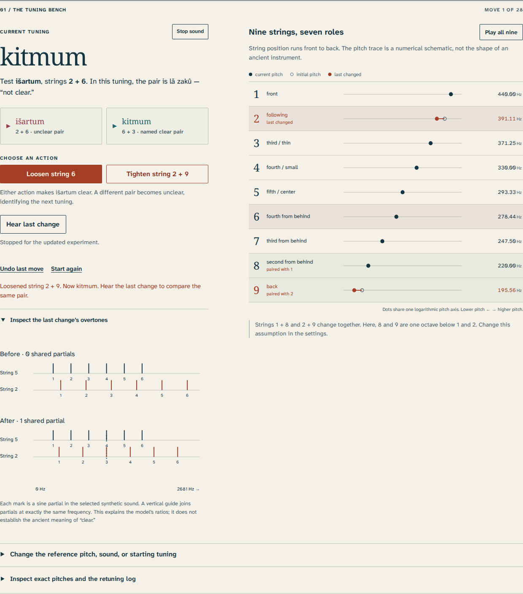

# Sammû

**Follow an ancient Mesopotamian retuning procedure, one string at a time.**

[](LICENSE)
[](https://antonsoo.github.io/sammu/)

A tuning name tells you how strings relate; it does not fix their absolute pitches. Sammû makes that distinction audible. Test a pair, loosen or tighten the prescribed string, compare the **same pair** before and after, and follow the reconstructed seven-tuning procedure from Old Babylonian manuscripts found at Ur.



[Open the workshop](https://antonsoo.github.io/sammu/) · [Try seven loosening steps](https://antonsoo.github.io/sammu/?start=isartum&a=440&companions=octave&sound=plucked&moves=LLLLLLL#cycle) · [Sources and interpretation](docs/sources.md)

## Start locally

Requires Node.js 24 or later.

```sh
git clone https://github.com/antonsoo/sammu.git
cd sammu
npm ci && npm run dev
```

Open `http://127.0.0.1:4384/sammu/`. Production output is `dist/`:

```sh
npm run build
npm run preview
```

## What you can investigate

- Play the current diagnostic pair, the tuning’s named clear pair, or any of nine individual strings. Two explicitly synthetic sounds expose the role of upper partials.
- Loosen or tighten the string selected by the reconstructed procedure. Strings 1 + 8 and 2 + 9 change together. Undo restores exact pitches.
- Compare the same physical pair before and after the last action. The overtone diagram marks coinciding partials using exact rational equality.
- Plan a route to another named tuning. Any destination is at most three operations away; applying a route executes the actual retuning steps.
- Complete a seven-step cycle and hear the difference between a returning name and a returning frequency. No pitch is silently normalized between tunings.
- Inspect every exact fraction and every action, or share a bounded URL containing the initial settings and complete move sequence.
- Save a standalone HTML study with embedded fonts, audio, original diagrams, all intermediate pitches, assumptions, source notes and font licenses. Print it to PDF, or download CSV, JSON, WAV and SVG separately.
- Use the workshop offline after its complete edition has been saved. The external scholarly articles and museum records remain online links.

## How the realization works

The source data describe physical string pairs and a retuning procedure. **The audible ratios are an explicit modern realization**, not numerical measurements recovered from a tablet.

Six designated clear pairs are constrained to frequency ratios `4/3` for a three-position string span or `3/2` for a four-position span. The remaining pair is left unclear. These six constraints form a connected path through seven strings. Starting with string 1 at ratio `1/1`, the core propagates exact fractions along that path.

For the initial išartum arrangement, the resulting relative frequencies are:

| String                | Ratio to initial string 1 | At a 440 Hz reference |
| --------------------- | ------------------------- | --------------------- |
| 1                     | 1/1                       | 440 Hz                |
| 2                     | 243/256                   | 417.65625 Hz          |
| 3                     | 27/32                     | 371.25 Hz             |
| 4                     | 3/4                       | 330 Hz                |
| 5                     | 2/3                       | 293.333333… Hz        |
| 6                     | 81/128                    | 278.4375 Hz           |
| 7                     | 9/16                      | 247.5 Hz              |
| 8, lower-octave model | 1/2                       | 220 Hz                |
| 9, lower-octave model | 243/512                   | 208.828125 Hz         |

An action solves the unclear pair’s constraint while holding its other string fixed. For example, the first loosening operation changes string 2 from `243/256` to `8/9`, and string 9 follows from `243/512` to `4/9`. No other string changes. The tuning becomes kitmum; the newly unclear pair is išartum, strings 2 + 6.

In this exact realization, each loosening multiplies its selected string by `2048/2187`; tightening uses the reciprocal. Over seven operations, every primary string changes once. Consequently:

```text
seven loosening operations
išartum -> kitmum -> embūbum -> pītum -> nīd(i) qablim
        -> nīš tuḫrim -> qablītum -> išartum

tuning name:       returns
each frequency:    multiplied by 2048/2187
opposite operation: restores the exact preceding pitches
```

This is a consequence of the chosen ratio model. It is not a claim that ancient musicians measured these fractions, used a modern absolute pitch standard, or followed an entire same-direction cycle during a performance.

`src/core/` contains the exact tuning, URL, audio-plan and export-record logic, separate from the DOM. Fractions use `BigInt`. Sessions are limited to 28 operations. The live player renders a finite `AudioBuffer`; downloaded mono PCM16 WAVs use the same synthesis at 48 kHz. The six-partial colour is an additive synthetic signal with a decaying envelope, not a sampled ancient instrument.

## Evidence and interpretation

The procedure is reconstructed from fragmentary witnesses and evidence separated in time. The workshop distinguishes three cases with different preservation: a supplied omission in the first, a restored result in the second, and extensive restoration in the third. It offers normalized Akkadian word notes without inventing a cuneiform transcription or recorded ancient pronunciation.

The principal sources are [Mirelman (2013)](https://journal.iftawm.org/previous/vol2no2/mirelman/), [Mirelman and Krispijn (2009)](https://doi.org/10.1017/S0021088900000735), and [Rahn (2022)](https://mtosmt.org/issues/mto.22.28.1/mto.22.28.1.rahn.html). Catalogue links identify [UET VII 74](https://cdli.earth/artifacts/347039) and [CBS 10996](https://cdli.earth/artifacts/254475). [The source ledger](docs/sources.md) records exact locations, disagreements, dating and reuse boundaries.

The instrument’s precise identification is uncertain. The two companion-string models, unison and lower octave, are alternatives. The surviving text does not establish hertz, these exact frequency fractions, instrument dimensions, sound colour, or an ancient performance. The terms _zakû_ and _lā zakû_ require interpretation; the app does not equate them with a universal pleasantness score. The source notes remain available offline, but article PDFs, photographs and third-party recordings are not redistributed.

## Review and independent checks

```sh
npm run check
npm run verify:tuning
npm run test:browser -- /tmp/sammu-review/browser.json
python3 -m pip install -r scripts/requirements-audio.txt
python3 scripts/audio-oracle.py /tmp/sammu-review/browser.json
```

The browser script uses Playwright’s installed Chromium and Firefox. On a new machine, install its browsers with `npx playwright install --with-deps chromium firefox` first. Python 3.12 and NumPy 2.4.4 are used for the audio review; the exact-ratio oracle needs only Python’s standard library. For an isolated Python environment, install the requirements in a venv rather than the system environment.

The exact-ratio oracle uses Gaussian elimination on prime-exponent constraints, an independent source-order fixture, and breadth-first route search. It checks 812 states, 7,308 string pitches and all 49 shortest routes. Browser review exercises keyboard retuning, focus preservation, history navigation, source details, real downloads, native saved studies and offline operation in both engines at 1440 px and 375 px. The audio oracle independently reconstructs the expected notes and synthesizes every sample of downloaded WAVs and captured live buffers. [The retained review](docs/review.md) gives the measured results and their limits.

## Contributing

Please preserve the distinction between source text, scholarly reconstruction and numerical realization. A new historical claim needs an identifiable source and a location within it. A new audio or tuning model should be selectable and named, with independent numerical evidence. See [CONTRIBUTING.md](CONTRIBUTING.md).

## License

Original code, diagrams and synthesis: [MIT](LICENSE), © 2026 Anton Soloviev. Self-hosted fonts: SIL Open Font License 1.1, with notices in `public/fonts/` and in exported studies. Modern scholarship, photographs and recordings linked by the app retain their respective rights.
